# 🚀 CTRL ALT CRAC INNOVATIONS (CAC INNOVATION)
### *Integrated Business Management & AI Delivery Platform*

[](https://fastapi.tiangolo.com)
[](https://www.python.org/)
[](https://www.sqlite.org/)
[](https://www.sqlalchemy.org/)
[](https://pytorch.org/)
[](https://cac-innovations.com)
[](#1-six-connected-roles--access-matrix)

---

## 📖 Complete Business Lifecycle Architecture

**CTRL ALT CRAC INNOVATIONS (CAC INNOVATION)** is an integrated business management and AI delivery platform, engineered as a unified connected platform rather than disconnected websites.

```mermaid
flowchart LR
    A["1. Client Inquiry"] --> B["2. AI Lead Qualification"]
    B --> C["3. Admin / BD Onboarding"]
    C --> D["4. Manager Sprint Planning"]
    D --> E["5. Task Allocation (Dev & Interns)"]
    E --> F["6. Code Submission (GitHub PR)"]
    F --> G["7. Manager Approval Gate"]
    G --> H["8. Client Milestone Delivery & Invoice"]
    H --> I["9. Support & AI Maintenance"]
```



### The Connected Lifecycle Workflow:
1. **Client Submits Requirement**: Inbound brief captured via quote form or AI Assistant.
2. **AI Lead Qualification**: AI analyzes budget, timeline, and tech scope, auto-scoring intent (1–100).
3. **Admin Onboarding (1-Click)**: Admin converts won lead into Client & Project record with assigned Project Manager.
4. **Manager Sprint Planning**: Manager creates milestone deliverables and uses the **AI Project Planner** for task breakdowns.
5. **Task Allocation**: Tasks assigned to Senior Developers (Employees) or Supervised AI Fellows (Interns) with priorities (*Critical, High, Medium, Low*).
6. **Code Submission (GitHub Integration)**: Assignee submits Git branch, Pull Request URL, and test results (`Status: Under Review`).
7. **Manager Approval Gate**: Manager reviews diffs and either requests changes or approves (`Status: Approved` &rarr; updates project completion %).
8. **Client Delivery & Invoicing**: Client portal updates with approved deliverables, documents, and milestone-based invoice tracking.
9. **Support & Maintenance**: Post-delivery ticketing system with SLA response tracking.

---

## 👥 1. Six Connected Roles & Access Matrix

All 6 roles operate inside one connected system, with backend-enforced RBAC ensuring users only see what is relevant to their role:

| Role | Responsibilities | Dedicated Workspace |
|---|---|---|
| **Super Admin** | Full system configuration, user privileges, security audit logs, platform settings | [`/admin`](http://127.0.0.1:8000/admin) |
| **Admin / Business Dev** | Inbound leads, quotations, 1-click client onboarding, contracts, milestone invoices | [`/admin`](http://127.0.0.1:8000/admin) |
| **Manager / Project Lead** | Project planning, task allocation, team workload, code review decisions, delivery approvals | [`/manager`](http://127.0.0.1:8000/manager) |
| **Employee / Senior Dev** | Core module development, PR submission, technical documentation, delegating subtasks to interns | [`/employee`](http://127.0.0.1:8000/employee) |
| **Intern (AI Fellow)** | Assigned learning & development tasks, submitting PR links, receiving mentor rubric scores | [`/intern`](http://127.0.0.1:8000/intern) |
| **Client** | Reviewing approved milestones & deliverables, tracking invoices, opening support tickets | [`/client`](http://127.0.0.1:8000/client) |

---

## 🔑 2. Initial Super Admin Access & Employee Provisioning

There are **zero default employee accounts**. The platform starts clean with a single root Super Admin account. All employee credentials (Project Managers, Developers, Interns, Business Development) are created and managed directly by the Administrator through the **Admin Portal** or API:

| Role | Initial Email | Default Password | Notes |
|---|---|---|---|
| 👑 **Super Admin** | `admin@cac-innovations.com` | `Admin@123456` | Root platform administrator |
| 👑 **Executive CEO** | `ceo@cac-innovations.com` | `Ceo@123456` | Dedicated gateway at [`/ceo`](http://127.0.0.1:8000/ceo) |

### 🔒 Executive CEO Access & Standard Login Governance Policy:
1. **Dedicated Gateway**: The CEO logs in via [`http://127.0.0.1:8000/ceo`](http://127.0.0.1:8000/ceo).
2. **Attempt 1 on `/login` (Warning)**: If someone attempts to log in with CEO credentials on the standard staff login page, the system blocks the session and displays an **Executive Security Warning** directing them to `/ceo`.
3. **Attempt 2 on `/login` (Security Alert)**: If CEO credentials are submitted a 2nd time on `/login`, the system triggers a **Security Alert & Lockout**, permanently flagging the incident in the Security Audit Stream.
4. **Role Type Selection Required**: All staff on [`/login`](http://127.0.0.1:8000/login) must select their designated Role Type (`intern`, `employee`, `manager`, `admin`, `client`). Mismatches are rejected with a clear explanation.

### How the Admin Provisions Employee Credentials:
1. Log in at [`/login`](http://127.0.0.1:8000/login) with `admin@cac-innovations.com` / `Admin@123456`.
2. Go to the **Admin Portal** ([`/admin`](http://127.0.0.1:8000/admin)).
3. Under **Employee & Team Credential Provisioning**, click **`+ Provision New Employee Account`**.
4. Enter the team member's Name, Email, Password, and Role (`manager`, `employee`, `intern`, `admin`, or `client`).
5. Click **Create & Issue Credentials**. The employee can immediately log in to their assigned portal.

---

## 🤖 3. Role-Aware AI Assistant & Specialized Copilots

The CAC AI Assistant adapts dynamically based on the authenticated user's role:

- **Admin**: Analyzes inbound lead quality, prepares customized quotation estimates, summarizes business revenue.
- **Manager**: AI Project Planner tool that breaks client specifications into 3-phase sprint breakdowns with task dependencies and role allocations.
- **Employee**: Code Review Assistant that generates pytest unit test cases, checks security boundaries, and inspects PRs.
- **Intern**: Intern Mentor that clarifies task instructions, explains design patterns, and provides rubric checklist tips.
- **Client**: Answers queries strictly regarding approved project milestones, deliverables, and service scopes.

---

## 📂 4. Project Structure

```
CAC/
├── app/
│   ├── main.py                     # FastAPI application factory & routes
│   ├── core/
│   │   ├── config.py               # Pydantic v2 SettingsConfigDict configuration
│   │   ├── security.py             # Bcrypt hashing & JWT token handling
│   │   └── permissions.py          # 6-Role RBAC dependency checkers
│   ├── database/
│   │   ├── base.py                 # SQLAlchemy declarative base
│   │   ├── session.py              # SQLite3 session factory
│   │   └── init_db.py              # Database seeding script (6 roles, projects, tasks)
│   ├── models/
│   │   ├── user.py                 # User & Role models
│   │   ├── content.py              # Service, Industry, Portfolio & CRM Lead models
│   │   ├── client_project.py       # Client, Project, Milestone, Task, Notification, Invoice
│   │   ├── ai.py                   # AIAgent, KnowledgeBase, KBDocument & AIUsageLog
│   │   ├── intern.py               # InternBatch, InternTask & InternSubmission
│   │   └── audit.py                # Security audit logging
│   ├── schemas/
│   │   ├── user.py                 # User authentication schemas
│   │   ├── content.py              # CRM lead qualification schemas
│   │   ├── client_project.py       # Task allocation, PR submit & invoice schemas
│   │   └── ai.py                   # Agent chat & RAG schemas
│   ├── services/
│   │   ├── crm_service.py          # Lead qualification auto-scoring engine
│   │   ├── project_service.py      # Lead-to-project conversion, task review & progress
│   │   └── ai_service/
│   │       ├── provider.py         # Role-scoped AIProvider & CACInternalEngine
│   │       ├── rag_engine.py       # Sliding-window chunking & BM25/cosine retrieval
│   │       └── agent_manager.py    # Sandboxed tool calling & execution logger
│   ├── routers/
│   │   ├── auth.py                 # /api/v1/auth (JWT login & logout)
│   │   ├── services.py             # /api/v1/services (Service catalogue)
│   │   ├── industries.py           # /api/v1/industries (Sector solutions)
│   │   ├── portfolio.py            # /api/v1/portfolio (Case studies)
│   │   ├── enquiries.py            # /api/v1/enquiries (Leads & CRM)
│   │   ├── clients.py              # /api/v1/clients (Tenant management)
│   │   ├── projects.py             # /api/v1/projects (Tasks, milestones, invoices, notifs)
│   │   ├── agents.py               # /api/v1/agents (Live agent chat & tools)
│   │   ├── knowledge_bases.py      # /api/v1/knowledge-bases (RAG query & ingestion)
│   │   ├── interns.py              # /api/v1/interns (Cohort tasks & rubrics)
│   │   └── web.py                  # HTML Jinja2 router for all 6 role portals
│   ├── static/
│   │   ├── css/style.css           # Glassmorphism design system & responsive layout
│   │   ├── js/main.js              # CRM lead handlers, toasts, and logout
│   │   ├── js/chat-widget.js       # Floating interactive AI assistant widget
│   │   └── images/logo.jpeg        # 3D isometric cube CAC logo
│   └── templates/
│       ├── base.html               # Master layout with role-aware navigation
│       ├── index.html              # Homepage with 3 pillars, services & quote brief
│       ├── about.html              # Mission, vision, and 4-stage delivery process
│       ├── services.html           # Full 8-service enterprise catalogue
│       ├── industries.html         # 6 industry solutions & governance safeguards
│       ├── products.html           # Configurable AI products & live RAG sandbox
│       ├── portfolio.html          # Verified client case studies & metrics
│       ├── training.html           # 5-track fellowship & application form
│       ├── contact.html            # Consultation inquiry brief form
│       ├── login.html              # Unified login with 1-click test buttons for all 6 roles
│       ├── admin_portal.html       # Super Admin & BD Console (CRM, Client Onboarding, Invoices)
│       ├── manager_portal.html     # Manager Workspace (Task Assignment, Review Decisions, AI Planner)
│       ├── employee_portal.html    # Developer Workspace (Assigned Tasks, Submit PRs, Delegate to Interns)
│       ├── client_portal.html      # Client Workspace (Milestones, Invoices, Support Tickets)
│       └── intern_portal.html      # Intern Fellowship Workspace (Assigned Tasks, PR Submissions)
├── tests/
│   └── test_direct.py              # Automated Pytest suite (6 integration tests)
├── .env.example                    # Environment variable template
├── requirements.txt                # Python package dependencies
└── README.md                       # Documentation
```

---

## ⚡ 5. How to Run the Platform

### Step 1: Start the FastAPI Server
```powershell
python -m uvicorn app.main:app --host 127.0.0.1 --port 8000 --reload
```

### Step 2: Access in Your Browser
- **Public Website**: [http://127.0.0.1:8000](http://127.0.0.1:8000)
- **Unified Login**: [http://127.0.0.1:8000/login](http://127.0.0.1:8000/login) *(Click any of the 6 role buttons)*
- **Smart Portal Redirect**: [http://127.0.0.1:8000/portal](http://127.0.0.1:8000/portal)
- **Interactive Swagger API Docs**: [http://127.0.0.1:8000/docs](http://127.0.0.1:8000/docs)
- **ReDoc Technical Specs**: [http://127.0.0.1:8000/redoc](http://127.0.0.1:8000/redoc)

---

## 🧪 6. Automated Testing

Run the test suite:
```powershell
python -m pytest tests/test_direct.py -v
```

All 6 integration tests pass in ~2 seconds:
- `test_six_roles_and_users`: Verifies existence and permissions of all 6 roles.
- `test_lead_generation_and_scoring`: Verifies AI intent scoring and lead creation.
- `test_lead_conversion_to_client_and_project`: Verifies 1-click lead conversion into Client & Project with manager assignment.
- `test_task_lifecycle_workflow`: Tests task assignment &rarr; GitHub PR submission &rarr; manager approval.
- `test_role_scoped_ai_assistants`: Verifies role-adapted AI outputs for Managers, Interns, and Clients.
- `test_rag_query_engine`: Verifies semantic passage retrieval and citation generation.

---

## 📜 License & Compliance

Copyright &copy; 2026 **CTRL ALT CRAC INNOVATIONS (CAC INNOVATION)**.  
All rights reserved. Built as a unified enterprise AI delivery and business management platform.
